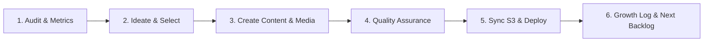

# Autonomous Website Growth & Profitability Engine

This skill guides the autonomous, daily improvement of the **Langtago / EvidenceLog** website (`langtago`) and Marketplace listing with a single relentless objective: **maximizing organic user engagement, conversion rate (CRO), and profitability.**

---

## 1. Operating Principles & Daily Workflow

On every daily execution (or when invoked directly), execute this 6-step loop:



### Step 1: Audit Current Site State
1. Inspect current landing page components in `langtago/components/` and pages in `langtago/app/`.
2. Review copy tone: Ensure it adheres to the **"Less is More"** enterprise SaaS standard (like Linear, Vanta, Stripe) with zero fluff or redundant frames.
3. Identify the highest-leverage growth area for today:
   - **Conversion Rate (CRO)**: Headlines, primary CTAs, objection handling, trust badges.
   - **Content & SEO**: New landing pages (e.g. `/compare/vanta`, `/solutions/hipaa`), rich blog guides, compliance checklists.
   - **Multimedia & Engagement**: Interactive calculators, video demo scripts, infographic assets, social proof.

### Step 2: Ideate & Prioritize
Choose **ONE high-impact improvement** per cycle to keep changes focused, verifiable, and measurable:
- **A/B Hook Experiments**: Test sharper Hero headlines targeted at engineering managers, compliance officers, or CTOs.
- **Objection Busters**: Add specific answers in `FAQ.tsx` (e.g., "How does EvidenceLog work with SOC 2 Type II audit windows?").
- **Case Study / Solution Stories**: Detail how teams save 120+ hours per audit cycle with 1-click evidence seals.
- **Interactive Widgets**: ROI calculator showing \$ Saved vs. manual auditor screenshotting.

### Step 3: Implement Content, Copy & Media
1. **Codebase Edits**: Modify or create components in `langtago/components/` or pages in `langtago/app/`.
2. **Media Assets**:
   - Generate or refine visual assets in `langtago/public/images/`.
   - Structure video scripts in `langtago/docs/marketing/video-scripts/` (Loom walkthroughs, 30s product teasers).
   - Author audio/podcast ad copy in `langtago/docs/marketing/audio-briefs/`.
3. **Asset Organization**: Maintain clean naming conventions and ensure zero broken links.

### Step 4: Rigorous Quality Assurance (Zero Regressions)
Before any build or deployment, run the complete verification gauntlet:
```bash
# 1. Typecheck
cd /Volumes/Projects/dev/langtago-evidencelog/langtago && npx tsc --noEmit

# 2. Lint check
cd /Volumes/Projects/dev/langtago-evidencelog/langtago && npm run lint

# 3. Backend tests
cd /Volumes/Projects/dev/langtago-evidencelog/evidencelog-jira && npm test
```
*Never deploy if any test, linter rule, or typecheck fails.*

### Step 5: S3 Asset Sync & Production Deployment
1. **S3 File Sync (Cloud Storage Assets)**:
   - If AWS credentials (`AWS_ACCESS_KEY_ID`, `AWS_SECRET_ACCESS_KEY`, `S3_BUCKET_NAME`) are configured:
     ```bash
     aws s3 sync /Volumes/Projects/dev/langtago-evidencelog/langtago/public/ s3://$S3_BUCKET_NAME/assets/ --delete --cache-control max-age=31536000
     ```
   - If AWS CLI is not configured, fall back to project-bundled public asset delivery and log a note.
2. **Build & Deploy**:
   - Run the production build:
     ```bash
     cd /Volumes/Projects/dev/langtago-evidencelog/langtago && npm run build
     ```
   - Execute production deployment via the verified pipeline:
     ```bash
     cd /Volumes/Projects/dev/langtago-evidencelog/langtago && ./scripts/deploy.sh production
     ```
   - Commit all changes to git and push to GitHub `main`.

### Step 6: Log Executive Summary Artifact
Create a daily progress log entry in `docs/growth/daily_growth_ledger.md` detailing:
- **Experiment Deployed**: What was updated and why.
- **Hypothesis**: Expected impact on conversion / engagement / SEO.
- **Files Modified**: Clickable links to code changes.
- **Next Day's Backlog**: 3 prioritized growth ideas for tomorrow.

---

## 2. Growth Backlog & Playbooks

### Playbook A: High-Converting SEO Landing Pages
Target high-intent search queries from engineering and security teams:
- `/compare/manual-screenshots-vs-evidencelog`: The true cost of manual change evidence.
- `/frameworks/soc2-cc81`: Complete technical guide to satisfying CC8.1 in Jira.
- `/frameworks/iso-27001-a832`: Change management automation for ISO 27001:2022.
- `/integrations/vanta-drata`: How to pipe sealed Jira change evidence into GRC tools.

### Playbook B: Interactive Engagement Tools
- **Auditor ROI Calculator**: Sliders for (Number of Devs, Releases per Month, Auditor Hourly Rate) -> Shows annual \$ and hours saved.
- **Interactive Policy Simulator**: Lets visitors test if a sample Git commit + PR would pass SOC 2 controls.

### Playbook C: Multimedia & Social Video
- **30-Second Shorts / Reels**: "How to stop taking screenshots for your SOC 2 audit" (Script template in `docs/marketing/`).
- **Product Walkthrough**: 2-minute clean screen recording demonstrating 1-click developer remediation.

---

## 3. Safety & Guardrails
- **Design Integrity**: Always adhere to the established Contis clean SaaS design language (white surfaces, slate borders, emerald accents, zero 2000s card clutter).
- **Zero Breakages**: Never push changes that break Next.js build or Forge backend compatibility.
- **Transparent Logging**: Always record what was changed in git with clear conventional commit messages (`feat(growth): ...`, `content(seo): ...`).
