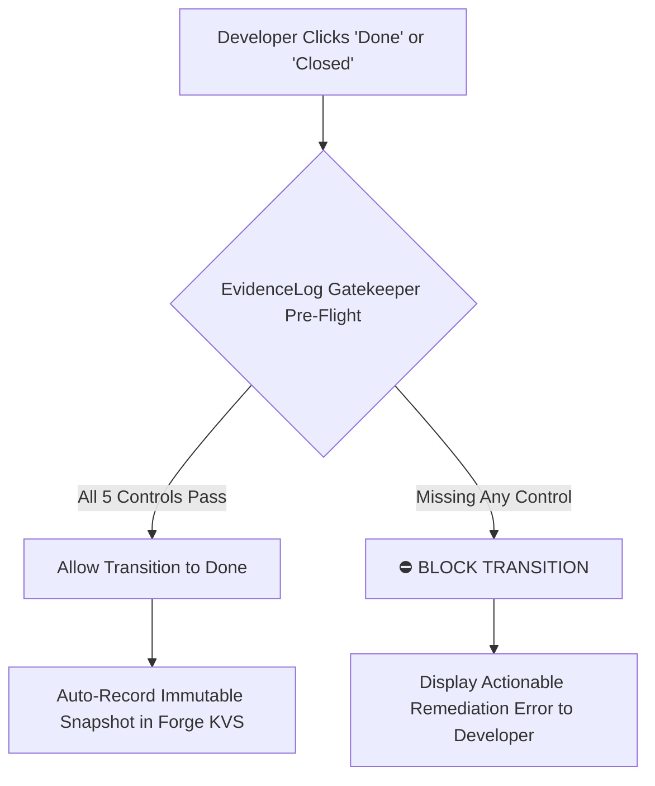

# EvidenceLog for Jira — Production User & Administration Guide
### Enterprise SOC 2 Type II & ISO/IEC 27001 Change-Management Compliance Ledger
**Publisher:** Langtago • [https://langtago.com](https://langtago.com) • [support@langtago.com](mailto:support@langtago.com)  
**Document Version:** 4.2.0 (Commercial Production Release)  
**Applicable Platform:** Atlassian Forge (Jira Cloud Native — 100% Zero Data Egress)

---

## Table of Contents
1. [Product Overview & Value Proposition](#1-product-overview--value-proposition)
2. [Quickstart Guide: From Zero to Certified Audit Trail](#2-quickstart-guide-from-zero-to-certified-audit-trail)
3. [The Five Core Compliance Pillars](#3-the-five-core-compliance-pillars)
   - [Pillar 1: Acceptance Criteria (Requirements Traceability)](#pillar-1-acceptance-criteria-requirements-traceability)
   - [Pillar 2: Code Linkage & CI/CD Pipelines](#pillar-2-code-linkage--cicd-pipelines)
   - [Pillar 3: Segregation of Duties & CAB Approvals](#pillar-3-segregation-of-duties--cab-approvals)
   - [Pillar 4: QA & Functional Testing Verification](#pillar-4-qa--functional-testing-verification)
   - [Pillar 5: Security Scanning & SAST/DAST Trace Detection](#pillar-5-security-scanning--sastdast-trace-detection)
4. [Using the Issue Compliance Panel](#4-using-the-issue-compliance-panel)
   - [Lifecycle Stage Tracker](#lifecycle-stage-tracker)
   - [One-Click Remediation ("Fix It For Me")](#one-click-remediation-fix-it-for-me)
   - [7-Tab Audit Export Drawer](#7-tab-audit-export-drawer)
   - [Instant Certification & KVS Version History](#instant-certification--kvs-version-history)
5. [The Preventive Workflow Gatekeeper](#5-the-preventive-workflow-gatekeeper)
   - [How Transitions are Enforced](#how-transitions-are-enforced)
   - [Resolving Transition Blocks](#resolving-transition-blocks)
6. [The Project Audit Hub (Executive Dashboard)](#6-the-project-audit-hub-executive-dashboard)
   - [5 Real-Time KPI Scorecards](#5-real-time-kpi-scorecards)
   - [One-Click Batch Certification Engine](#one-click-batch-certification-engine)
   - [Emergency Hotfix Alerts & CAB Tracking](#emergency-hotfix-alerts--cab-tracking)
   - [Exporting Release Audit Dossiers & Executive Attestations](#exporting-release-audit-dossiers--executive-attestations)
7. [Auditor & Compliance Officer Workflows](#7-auditor--compliance-officer-workflows)
   - [Jira JQL Query Library](#jira-jql-query-library)
   - [Continuous Audit Ingestion: Vanta & Drata](#continuous-audit-ingestion-vanta--drata)
   - [Printable Formal Audit Certificates](#printable-formal-audit-certificates)
8. [Zero-Trust Cryptographic Verification](#8-zero-trust-cryptographic-verification)
   - [SHA-256 Fingerprint Calculation](#sha-256-fingerprint-calculation)
   - [Binary Release Merkle Root Proofs](#binary-release-merkle-root-proofs)
   - [Offline Auditor Verifier Application](#offline-auditor-verifier-application)
9. [Administrator Guide: Policy Configuration & Security](#9-administrator-guide-policy-configuration--security)
   - [Project Compliance Policy Thresholds](#project-compliance-policy-thresholds)
   - [Permissions & Atlassian Cloud Data Residency](#permissions--atlassian-cloud-data-residency)
10. [Frequently Asked Questions (FAQ) & Troubleshooting](#10-frequently-asked-questions-faq--troubleshooting)

---

## 1. Product Overview & Value Proposition

During SOC 2 Type II, ISO/IEC 27001, HIPAA, or FedRAMP audits, organizations routinely lose 40–80 engineering hours compiling spreadsheets, hunting down pull request links, and taking screenshots of closed Jira tickets. Worse, traditional audit sampling checks only 25–40 arbitrary tickets after deployment, missing unauthorized changes, skipped QA sign-offs, or bypassed security reviews.

**EvidenceLog for Jira** replaces manual post-deployment audits with **continuous, preventive, and cryptographically verified change management**:

* **Continuous Evaluation:** Automatically inspects Jira ticket metadata, ADF descriptions, multi-cloud Git links (GitHub, GitLab, Bitbucket, Azure DevOps), transition changelogs, QA artifacts, and vulnerability scanners in real time.
* **Preventive Workflow Gatekeeper:** Programmatically blocks developers from resolving or closing tickets until all compliance criteria are satisfied.
* **Cryptographic Tamper-Evidence:** Generates immutable SHA-256 fingerprints and release-wide binary Merkle tree roots stored directly in Atlassian Forge encrypted Key-Value Storage (KVS).
* **100% Cloud-Native & Zero Data Egress:** Runs entirely inside Atlassian's secure Forge sandbox. No external servers, no third-party database leaks, and $0.00 cloud infrastructure maintenance.

```
┌────────────────────────────────────────────────────────────────────────┐
│                        EVIDENCELOG WORKFLOW                            │
├───────────────┬────────────────────────┬───────────────────────────────┤
│  1. DEVELOP   │  2. VERIFY IN-SITU     │  3. PREVENT & CERTIFY         │
│  Engineer     │  EvidenceLog panel     │  Gatekeeper blocks 'Done'     │
│  creates PR & │  validates 5 controls  │  until all checks pass;       │
│  links code   │  with real-time badges │  computes SHA-256 certificate │
└───────────────┴────────────────────────┴───────────────────────────────┘
```

---

## 2. Quickstart Guide: From Zero to Certified Audit Trail

Follow these four steps to start certifying compliance on Jira issues:

### Step 1: Open Any Jira Issue
Navigate to any development ticket in your project. In the right-hand sidebar (or under the issue title), look for the **EvidenceLog Compliance** panel.

### Step 2: Review Compliance Status
The panel renders an immediate status:
* 🟢 **AUDIT READY (5/5 Controls Verified):** The issue satisfies all regulatory change criteria.
* 🟠 **ACTION REQUIRED (N/5 Controls Missing):** The issue is missing required evidence (e.g. Acceptance Criteria, Git link, QA sign-off, or Security Scan).

### Step 3: Use 1-Click Remediation
If an item is missing, click any of the **"Fix It For Me"** buttons directly inside the panel:
* Click `[+ Append AC Template Checklist]` to insert a Given/When/Then BDD format.
* Click `[+ Apply "qa-verified" Label]` to instantly add the verified QA tag.
* Click `[+ Post QA Sign-off Comment]` to record a formal test verification note.

### Step 4: Certify & Export Evidence
Once all controls turn green, click **"⚡ Certify & Save Snapshot"**. EvidenceLog calculates an immutable SHA-256 hash, commits it to Forge encrypted storage, and marks the issue permanently **CERTIFIED**.

---

## 3. The Five Core Compliance Pillars

EvidenceLog continuously inspects each ticket against five rigorous compliance pillars aligned with **SOC 2 CC8.1 / CC6.8 / CC7.1** and **ISO 27001 Controls A.8.28 / A.8.29 / A.8.32**:

```
 ┌───────────────────────────────────────────────────────────────────────┐
 │                  5 COMPLIANCE VERIFICATION PILLARS                    │
 ├───────────────────────────────────────────────────────────────────────┤
 │ [✔] Pillar 1: Acceptance Criteria (BDD / DoD in description or field) │
 │ [✔] Pillar 2: Code Linkage & CI/CD (GitHub, GitLab, Bitbucket, Azure) │
 │ [✔] Pillar 3: Segregation of Duties (Author != Approver; or CAB sign) │
 │ [✔] Pillar 4: QA Verification (qa-verified tag, transition, or note)  │
 │ [✔] Pillar 5: Security Scanning (Snyk, SonarQube, Trivy, Dependabot)  │
 └───────────────────────────────────────────────────────────────────────┘
```

### Pillar 1: Acceptance Criteria (Requirements Traceability)
* **Standard:** SOC 2 CC8.1 • ISO 27001 A.8.32 • FedRAMP CM-3
* **What is Checked:** Evaluates the issue description and custom fields for clear requirements.
* **Passing Patterns:**
  * BDD statements: `Given [condition] When [action] Then [outcome]`
  * Explicit headers: `Acceptance Criteria:`, `Definition of Done:`, `AC:`, `a/c:`
  * Markdown checkbox checklists: `- [x] User authenticated via MFA`
  * Dedicated Jira custom fields containing acceptance specifications.

### Pillar 2: Code Linkage & CI/CD Pipelines
* **Standard:** SOC 2 CC8.1 • ISO 27001 A.8.32 • NIST PR.PS-02
* **What is Checked:** Queries Jira remote links, issue fields, and description for development artifacts.
* **Supported Providers:**
  * **GitHub:** Pull requests (`/pull/`), commits (`/commit/`), branch links, and GitHub Actions runs.
  * **GitLab:** Merge requests (`/merge_requests/`), repository links, and GitLab CI/CD pipelines.
  * **Bitbucket:** Pull requests (`/pull-requests/`), commits, and Bitbucket Pipelines.
  * **Azure DevOps:** Repositories (`/_git/`), pull requests, and Azure Pipelines.
  * Automated CI/CD pipeline verification flags passing build status automatically.

### Pillar 3: Segregation of Duties & CAB Approvals
* **Standard:** SOC 2 CC6.8 / CC8.1 • ISO 27001 A.5.3 • HIPAA §164.312
* **What is Checked:** Analyzes the issue creator (`reporter`), sole assignee, changelog transition history, and comments.
* **Rules:**
  * The author/assignee cannot self-approve or transition the issue to `Done` without an independent reviewer.
  * An independent reviewer transitioning the issue satisfies peer review.
  * Alternatively, an explicit peer review comment (e.g. `Approved by @lead`, `LGTM`, `Code review passed`) from an independent engineer satisfies peer review.
  * **JSM ITIL Changes:** Detects Jira Service Management Change tickets and verifies Change Advisory Board (`CAB`) authorization labels (`cab-approved`) or formal CAB sign-off comments.

### Pillar 4: QA & Functional Testing Verification
* **Standard:** SOC 2 CC8.1 • ISO 27001 A.8.29 • NIST DE.CM-01
* **What is Checked:** Scans workflow transitions, issue labels, comments, and attachments for testing artifacts.
* **Passing Patterns:**
  * Any QA workflow status transition (e.g. `In QA`, `Testing`, `UAT`, `Verified`).
  * Issue label: `qa-verified`, `qa-approved`, `tested`, or `uat-pass`.
  * Explicit QA comment (e.g. `QA Verification Sign-Off: All test scenarios passed`).
  * Attached test execution reports (`.xml`, `.json`, `.html`, `.csv`, `.log`).

### Pillar 5: Security Scanning & SAST/DAST Trace Detection
* **Standard:** SOC 2 CC7.1 • ISO 27001 A.8.28 • FedRAMP SA-11
* **What is Checked:** Evaluates comments and labels for automated vulnerability scanning results.
* **Supported Scanners:**
  * **Snyk:** Labels `snyk-passed`, `snyk-verified`, `snyk` or comments reporting `0 vulnerabilities`.
  * **SonarQube:** Labels `sonarqube-passed`, `sonar-passed` or Quality Gate passing comments.
  * **Trivy:** Container vulnerability scan pass tags (`trivy-passed`, `trivy`).
  * **Dependabot:** Clean dependency scan confirmation tags.
  * **OWASP ZAP:** Dynamic application security testing pass notes (`owasp-pass`, `owasp-zap`).
  * Security approval tags: `security-approved`, `security-verified`, `sec-review`.

---

## 4. Using the Issue Compliance Panel

The EvidenceLog panel sits inside every Jira issue view, giving engineers immediate visibility into their audit readiness:

### Lifecycle Stage Tracker
A 5-step visual progress bar displays the exact progress of the change:
```
[✔ 1. AC Defined] ──▶ [✔ 2. Code Linked] ──▶ [✔ 3. Peer Reviewed] ──▶ [✔ 4. QA Verified] ──▶ [✔ 5. Certified]
```

### One-Click Remediation ("Fix It For Me")
When an audit control is incomplete, interactive action buttons appear directly below the failing check. Developers can resolve missing criteria with a single click without leaving the ticket:
* `[+ Append AC Template Checklist]`: Automatically appends a Given/When/Then template comment.
* `[+ Apply "qa-verified" Label]`: Automatically adds the compliant QA verification label to Jira issue fields.
* `[+ Post QA Sign-off Comment]`: Posts an official testing confirmation timestamped by the user.

### Change Risk Rating Badge
EvidenceLog automatically classifies every issue according to **ITIL 4 Change Management**:
* 🟢 **Standard Change (Low Risk):** Low/Minor priority tasks and documentation changes. Standard approval applies.
* 🟡 **Normal Change (Medium/High Risk):** Production code modifications requiring peer review and QA verification.
* 🔴 **Emergency Change (Hotfix):** Triggered by labels `hotfix`, `emergency`, `sev1`, `outage` or summaries with hotfix keywords. Expedited approval permitted, but flags mandatory retroactive CAB review within 48 hours under SOC 2 CC8.1.

### 7-Tab Audit Export Drawer
Clicking **"Export Evidence Snapshot"** opens an interactive drawer with 7 export formats:
1. **Markdown Summary:** Human-readable executive summary ready to paste into pull requests or release notes.
2. **Printable Certificate:** Formal PDF/Print-ready compliance certificate with official seal and signature blocks.
3. **Vanta Ingestion:** Valid JSON formatted for continuous ingestion into Vanta.
4. **Drata Ingestion:** Valid JSON formatted for continuous ingestion into Drata.
5. **Raw Structured JSON:** Complete cryptographic evidence record containing all timestamps, actor IDs, and raw hashes.
6. **Auditor Spreadsheet CSV:** Ready-to-copy CSV row matching auditor sample matrices.
7. **Storage Version History:** Live inspection of the immutable `@forge/kvs` record history showing previous snapshot versions.

---

## 5. The Preventive Workflow Gatekeeper

The Preventive Gatekeeper (`jira:workflowValidator`) prevents compliance drift by **programmatically blocking developers from closing non-compliant tickets**.



### How Transitions are Enforced
When a user attempts to transition an issue to `Done`, `Resolved`, or `Closed`, the gatekeeper intercepts the transition and evaluates all 5 compliance controls:
* If all controls pass: The transition succeeds immediately, and EvidenceLog automatically records an encrypted snapshot in KVS.
* If any control fails: The transition is blocked, and Jira displays a red error dialog explaining the exact missing evidence.

### Resolving Transition Blocks
The error message identifies the exact missing item:
> `[EvidenceLog Gatekeeper] Transition blocked by SOC 2 change control policy: Missing explicit Acceptance Criteria (Given/When/Then or DoD) in issue description | Missing linked Git development artifact (Pull Request or branch link). Please resolve all required evidence before closing.`

To resolve the block, simply use the 1-click remediation buttons in the EvidenceLog panel, attach your PR, and transition the issue again.

---

## 6. The Project Audit Hub (Executive Dashboard)

Accessed via the left project navigation sidebar (**"EvidenceLog Audit Hub"**), this central dashboard provides Engineering Leads, QA Managers, and Compliance Officers with a single pane of glass across the entire project.

### 5 Real-Time KPI Scorecards
* **Overall Audit Readiness (%):** Percentage of tickets meeting 100% of SOC 2 / ISO 27001 requirements.
* **Permanently Certified:** Count of immutable snapshots committed to encrypted storage.
* **Traceability Pass Rate (%):** Percentage of issues containing linked PRs and acceptance criteria.
* **Segregation of Duties Rate (%):** Percentage of issues peer-reviewed by an independent engineer.
* **QA Verification Rate (%):** Percentage of issues with verified testing sign-offs.

### One-Click Batch Certification Engine
Release managers can certify all audit-ready tickets in an upcoming release in seconds. Clicking **`[⚡ Batch Certify ({count})]`** processes every compliant ticket across the project, generates cryptographic fingerprints, and commits them to Forge KVS in one transaction.

### Emergency Hotfix Alerts & CAB Tracking
Hotfixes and Sev-1 incidents are automatically pulled into an executive alert banner at the top of the hub, alerting leads to any emergency deployments pending retroactive post-incident CAB review.

### Exporting Release Audit Dossiers & Executive Attestations
Clicking **"Export Release Audit Dossier"** provides four comprehensive deliverables:
1. **Consolidated Markdown Dossier:** Multi-page audit summary covering all release tickets.
2. **Release Auditor CSV Matrix:** Complete spreadsheet with columns for issue key, author, approver, QA signer, status, and SHA-256 fingerprint.
3. **Release Merkle Root Proof:** Binary SHA-256 tree root cryptographically anchoring the entire release.
4. **Printable Executive Release Attestation (PDF):** Formal executive compliance document with sign-off blocks for VP of Engineering, CISO, and External Lead Auditor.

---

## 7. Auditor & Compliance Officer Workflows

EvidenceLog is built for seamless collaboration with external Big 4 auditors (PwC, EY, KPMG, Deloitte) and compliance platforms (Vanta, Drata).

### Jira JQL Query Library
Auditors can sample and filter issues directly using Jira's native search engine:

```jql
-- 1. All Audit-Ready Tickets in Project:
project = "DEMO" AND status = Done AND issue.property[evidencelog_compliance].isAuditReady = "true"

-- 2. Non-Compliant Tickets Missing Evidence (Exception Sampling):
project = "DEMO" AND status = Done AND issue.property[evidencelog_compliance].isAuditReady = "false"

-- 3. Emergency Hotfixes Requiring Post-Incident CAB Review:
project = "DEMO" AND issue.property[evidencelog_compliance].riskLevel = "EMERGENCY"

-- 4. Certified Tickets Locked in Forge Encrypted Storage:
project = "DEMO" AND issue.property[evidencelog_compliance].certified = "true"
```

### Continuous Audit Ingestion: Vanta & Drata
EvidenceLog generates continuous compliance JSON payloads formatted for direct ingestion:
* **Vanta:** Schema version 1.0 change management evidence containing pull request linkages, peer reviewers, and QA validation tags.
* **Drata:** Structured audit payload with evidence timestamps, SHA-256 fingerprint hashes, and regulatory standard mappings.

### Printable Formal Audit Certificates
Each certified issue includes an executive **Printable Audit Certificate** accessible from the export drawer:
* Official tamper-evident verification seal.
* Complete changelog transition timeline with actor IDs.
* SHA-256 cryptographic digest block.
* Physical signature and date blocks for Lead Auditor sign-off.

---

## 8. Zero-Trust Cryptographic Verification

EvidenceLog follows zero-trust security: auditors do not need to trust Jira or Langtago. Every certified record can be independently verified offline.

### SHA-256 Fingerprint Calculation
For each ticket, EvidenceLog canonicalizes the compliance record (key, summary, creator, approver, QA signer, status timeline, and remote PR links) into a deterministic JSON string and computes a **256-bit SHA-256 cryptographic hash**:
$$\text{Fingerprint} = \text{SHA-256}(\text{Canonical JSON Payload})$$

### Binary Release Merkle Root Proofs
For release batches, EvidenceLog constructs a binary Merkle tree across all issue hashes:
* Leaf nodes represent individual ticket SHA-256 fingerprints.
* Pairs of leaves are concatenated and hashed together hierarchically:
$$\text{Parent} = \text{SHA-256}(\text{Left Hash} + \text{Right Hash})$$
* The single resulting **Merkle Root** anchors the integrity of the entire release. If even a single character in a linked PR or comment changes, the root hash changes completely.

### Offline Auditor Verifier Application
Auditors can open [docs/verifier.html](docs/verifier.html) directly in any modern browser (`file:///` protocol) without internet access:
* Uses the native browser **Web Cryptography API** (`crypto.subtle`).
* Paste an exported evidence JSON snapshot to re-calculate its SHA-256 fingerprint in real time.
* Paste a batch of release tickets to verify the Merkle tree root hash.
* Confirms mathematical integrity with **zero network requests** and zero server egress.

---

## 9. Administrator Guide: Policy Configuration & Security

Jira Administrators can customize compliance thresholds to fit their organization's internal standards.

### Project Compliance Policy Thresholds
Configurable per-project via Forge KVS (`project_policy_${projectKey}`):

| Policy Setting | Default | Description |
| :--- | :---: | :--- |
| `requireAcceptanceCriteria` | `true` | Enforces explicit Given/When/Then or DoD specifications. |
| `requireDevLinks` | `true` | Enforces linked Git branch, commit, or PR remote links. |
| `requirePeerReview` | `true` | Enforces Segregation of Duties (author cannot close ticket). |
| `requireQASignoff` | `true` | Enforces QA status transition, QA label, or test sign-off. |
| `requireSecurityScan` | `true` | Enforces SAST scan traces (Snyk, SonarQube, Trivy, etc.). |
| `requireSASTForHighRisk` | `false` | When enabled, strictly blocks High-Risk / Hotfix changes unless SAST passed. |
| `requireRollbackPlanForHighRisk`| `false` | When enabled, requires documented rollback procedures for High-Risk changes. |
| `strictSegregationOfDuties` | `false` | When enabled, informal comment approvals are rejected; requires formal workflow transition. |
| `allowedQALabels` | Standard | Custom list of labels recognized as valid QA sign-offs. |
| `allowedEmergencyLabels` | Standard | Custom list of labels flagged as Emergency Hotfixes. |

### Permissions & Atlassian Cloud Data Residency
* **Data Residency:** Automatically inherits your Atlassian Cloud instance data residency (US, EU, Australia, etc.).
* **Storage Location:** All data is stored in Atlassian Forge encrypted Key-Value Storage (`@forge/kvs`). No external databases or AWS/GCP instances are used.
* **Network Egress:** EvidenceLog declares **zero egress permissions** (`network.domains` is empty). No source code or ticket data can leave Atlassian Cloud.
* **Least-Privilege Scopes:**
  * `read:jira-work`: Inspects issues and remote links.
  * `write:jira-work`: Applies quick remediation labels and comments.
  * `read:jira-user`: Resolves reviewer display names.
  * `read:issue-details:jira`: Reads changelog transition histories.
  * `storage:app`: Stores immutable audit records in Forge KVS.

---

## 10. Frequently Asked Questions (FAQ) & Troubleshooting

#### Q: Does EvidenceLog send any source code or ticket summaries to Langtago servers?
**A:** No. EvidenceLog is built 100% on Atlassian Forge. It runs in an isolated Node.js 22 sandbox inside Atlassian Cloud. There is zero data egress, zero third-party telemetry, and zero external database storage.

#### Q: How does EvidenceLog handle emergency hotfixes deployed at 2:00 AM?
**A:** Under ITIL 4 and SOC 2 CC8.1, emergency fixes can be deployed with expedited authorization. EvidenceLog flags these tickets as **Emergency Changes**, alerts release managers in the Audit Hub, and tracks them for mandatory retroactive CAB review within 48 hours.

#### Q: Can our external auditor verify our records without a Jira license?
**A:** Yes. Release managers can export the **Release Audit Dossier (CSV & Markdown)** or printable **Audit Certificates (PDF)**. External auditors can inspect these offline and verify their cryptographic SHA-256 hashes using the standalone [Offline Verifier](docs/verifier.html).

#### Q: How does EvidenceLog detect pull requests from GitHub or GitLab?
**A:** EvidenceLog queries Jira's native `Remote Links` API and issue fields. Any linked GitHub PR, GitLab MR, Bitbucket PR, or Azure DevOps commit associated with the ticket is automatically detected and parsed.

#### Q: What happens if an engineer edits a Jira ticket description after certification?
**A:** The certified snapshot is permanently locked in Forge KVS with the original SHA-256 fingerprint from the time of certification. If a new snapshot is taken, EvidenceLog retains the previous snapshot in its multi-version audit history (`snapshot_history_${key}`), preserving an immutable chain of custody.

---

### Need Assistance or Custom Compliance Mapping?
* **Website:** [https://langtago.com](https://langtago.com)
* **Support Email:** [support@langtago.com](mailto:support@langtago.com)
* **Developer Documentation Portal:** [docs/index.html](docs/index.html)
* **Offline Cryptographic Verifier:** [docs/verifier.html](docs/verifier.html)
